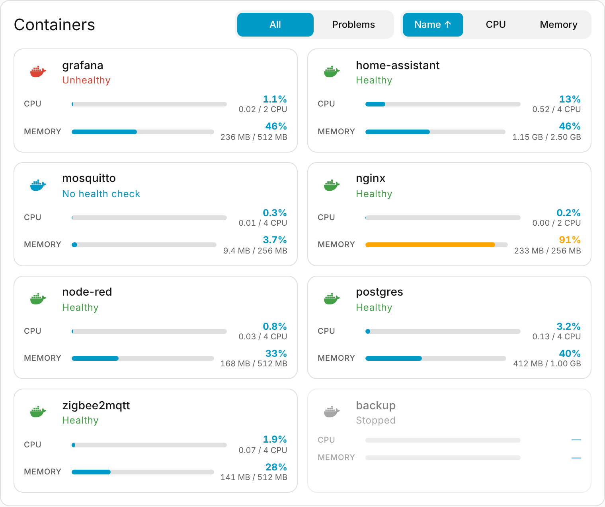

# Docker Monitor

<!-- ha-marketplace:exclude-start -->
[](https://github.com/roquerodrigo/ha-docker-monitor/actions/workflows/ci.yml)
[](https://github.com/roquerodrigo/ha-docker-monitor/releases/latest)
[](https://github.com/sponsors/roquerodrigo)

[](https://my.home-assistant.io/redirect/hacs_repository/?owner=roquerodrigo&repository=ha-docker-monitor&category=integration)
<!-- ha-marketplace:exclude-end -->

Follow your Docker containers from Home Assistant: how much CPU and memory each one uses, whether its health check passes, how long it has been running and which image it runs. Home Assistant reads this from Docker on the machine it runs on or on other machines in your network. Nothing goes through the cloud.



## Features

- See the CPU and memory use of every container, with the same figures as `docker stats`.
- Know when a health check fails, when a container stops and when it last restarted, and use it in automations.
- See which image and tag each container runs.
- Watch several machines, each added as its own entry.
- Add a dashboard card that lists your containers with their health, CPU and memory, and filters down to the ones with a problem.
- New containers appear on their own. A container recreated with `docker compose up` keeps its device and your entity settings.

## Requirements

- Home Assistant 2026.8.0 or newer.
- Docker on each machine you want to watch, and a way for Home Assistant to reach it: the Docker socket, or the Docker Engine API over your network.

### What access the integration needs

The integration only reads. It asks Docker for its version and the list of containers, inspects the running ones and reads one sample of their resource use. It never starts, stops or changes anything.

Docker itself has no read-only access level. Anyone who can reach its socket or its API can create containers, and through them take over the whole machine. Mounting the socket with `:ro` does not change this. Inspecting a container also returns its environment variables, which often hold passwords. The integration keeps only the values it shows, but the access is there.

So put a read-only proxy between Home Assistant and Docker, such as [docker-socket-proxy](https://github.com/Tecnativa/docker-socket-proxy). Set `CONTAINERS: 1` and leave everything else at its defaults: the proxy then answers the read requests the integration makes and refuses anything that would change a container.

### The machine Home Assistant runs on

Run the proxy next to Home Assistant:

```yaml
services:
  docker-socket-proxy:
    image: tecnativa/docker-socket-proxy
    environment:
      CONTAINERS: 1
    volumes:
      - /var/run/docker.sock:/var/run/docker.sock:ro
    ports:
      - 127.0.0.1:2375:2375
```

If Home Assistant uses `network_mode: host`, enter `tcp://127.0.0.1:2375` as the Docker host. If both containers share a Compose network instead, drop the `ports` lines and enter `tcp://docker-socket-proxy:2375`.

You can also mount the socket straight into the Home Assistant container and keep the default address. It is simpler, but it gives Home Assistant full control over Docker:

```yaml
services:
  homeassistant:
    volumes:
      - /var/run/docker.sock:/var/run/docker.sock
```

### Another machine

Run the same proxy on that machine and publish its port on an address of your local network, for example `192.168.1.10:2375:2375`. Then enter `tcp://192.168.1.10:2375` as the Docker host.

The Docker Engine API has no password and no encryption. Publish it only on a network you trust, never on the internet.

<!-- ha-marketplace:exclude-start -->
## Installation

### Home Assistant Marketplace (recommended)

1. Select the **Open your Home Assistant instance** button above, or go to **Settings → Marketplace**, select **Add from link** in the upper right corner, enter `roquerodrigo/ha-docker-monitor` and select **Add**.
2. Select **Install**.
3. Restart Home Assistant.

The Marketplace comes with Home Assistant 2026.11 and later. On older versions, add this repository to HACS as a custom repository of type **Integration** and install it from there.

### Manual

1. Download `docker_monitor.zip` from the [latest release](https://github.com/roquerodrigo/ha-docker-monitor/releases/latest).
2. Extract it into `config/custom_components/docker_monitor/`.
3. Restart Home Assistant.
<!-- ha-marketplace:exclude-end -->

## Configuration

Go to **Settings → Devices & services → Add integration**, search for **Docker Monitor** and fill in the form.

| Field       | What to enter                                                                                     | Default                       |
|-------------|---------------------------------------------------------------------------------------------------|-------------------------------|
| Docker host | A socket path such as `/var/run/docker.sock`, or a URL starting with `unix://`, `tcp://`, `http://` or `https://` | `unix:///var/run/docker.sock` |

Home Assistant connects to Docker before saving, so a wrong address is reported right away. An `https://` URL works when its certificate is one Home Assistant trusts. TLS client certificates and `ssh://` addresses are not supported.

Add the integration once for each machine. Each entry is named after its address.

To point an entry at a new address, open the integration and select **Reconfigure**. Docker has no password, so Home Assistant never asks you to sign in again.

## Options

Open the integration and select **Configure**. Saving reloads the integration.

| Setting                 | Default | Effect                                                                 |
|-------------------------|---------|------------------------------------------------------------------------|
| Scan interval (seconds) | 15      | Seconds between updates, 10 or more                                    |
| Device name suffix      | Empty   | Text added to every container name, to tell machines apart             |

With the suffix `NAS`, the container `grafana` becomes the device "grafana @ NAS" and its entity "grafana @ NAS CPU". Clear the field to remove the suffix. Changing it renames devices and entities, but entities created before the change keep their entity ID.

## Entities

Each running container becomes a device named after the container. The device page shows the image as the manufacturer and the full image reference as the version.

| Entity    | Type          | Shows                                                                                                   |
|-----------|---------------|---------------------------------------------------------------------------------------------------------|
| CPU       | Sensor        | CPU use in %, where 100 % is one fully used CPU. The `online_cpus` attribute holds how many CPUs the container can use |
| Memory    | Sensor        | Memory in use in MB, without the page cache. The `memory_limit_mb` attribute holds the container's limit |
| Uptime    | Sensor        | When the container last started, shown as how long it has been running                                 |
| Health    | Binary sensor | Problem or OK, from the container's health check. Only for containers that have one. Diagnostic         |
| Image     | Sensor        | The image without its tag, for example `ghcr.io/owner/app`. Diagnostic                                  |
| Image tag | Sensor        | The image tag, for example `1.27`. `latest` when the image has no tag, unknown when it is pinned only by digest or image ID. Diagnostic |

Health shows a problem for any status other than healthy, including while Docker is still running the first checks after a start.

When a container stops, its entities become unavailable and its device stays. A container you delete from Docker loses its device five minutes later.

## Dashboard card

The integration adds a card to your dashboards without any setup. Search for **Docker Monitor Card** in the card picker, or add it in YAML:

```yaml
type: custom:docker-monitor-card
```

The card lists each container with its health, a CPU bar and a memory bar. Buttons in the card switch between all containers and the ones with a problem, and sort by name, CPU or memory. Selecting the active sort again reverses it. Select a container to open its device page. You can set the card up in the visual editor.

| Option             | Accepts                                  | Default                              |
|--------------------|------------------------------------------|--------------------------------------|
| `title`            | Any text                                 | "Containers", in your language       |
| `devices`          | A list of device IDs                     | All containers                       |
| `mode`             | `all` or `problems`                      | `all`                                |
| `sort`             | `name`, `cpu`, `memory` or `health`      | `name`                               |
| `sort_direction`   | `asc` or `desc`                          | `asc` for `name`, `desc` for the rest |
| `columns`          | 1 to 6, fewer on narrow screens          | `2`                                  |
| `cpu_warning`      | 0 to 100 (%)                             | `80`                                 |
| `memory_warning`   | 0 to 100 (%)                             | `80`                                 |
| `show_unavailable` | `true` or `false`, to show stopped containers | `true`                          |

Both bars use the same scale: the share of what the container is allowed to use. CPU is measured against the CPUs available to the container, memory against its limit. The actual figures appear next to each bar. A container counts as a problem when it is stopped, when its health check fails or when a bar reaches its warning value. A container without a memory limit is measured against the machine's memory, which is what Docker reports in that case.

The card is available in English and Portuguese (Brazil). It is removed from your dashboard resources when you delete the last Docker Monitor entry.

## How it works

At every scan interval, Home Assistant lists the containers on each machine and asks Docker for the usage of the running ones. Docker takes about a second to measure CPU use, so right after Home Assistant starts, CPU and Memory stay empty for that long. Everything stays on your network.

Containers are recognized by name, so a container recreated under the same name keeps its device. Containers with generated names are left out: Compose `run` containers, names that look like a container ID and the BuildKit containers of temporary buildx builders.

If a machine does not answer within 30 seconds, its entities become unavailable until it answers again.

## Troubleshooting

**Setup says "Unable to connect to Docker".** Home Assistant cannot reach the address. With the socket, check that it is mounted into the Home Assistant container at that path. With a proxy, check that its port is reachable from Home Assistant and that `CONTAINERS: 1` is set, since the proxy refuses the container list without it.

**Setup says "Enter a socket path or a `unix://`, `tcp://`, `http://` or `https://` URL".** The address uses a scheme the integration does not support, such as `ssh://`, or has no host.

**A container is missing.** Only containers Home Assistant has seen running get a device, so start it once. If it has a generated name (see How it works above), give it a name.

**Health shows a problem right after a container starts.** Docker reports the health as starting until the first check passes, and the integration counts that as a problem.

**I cannot delete a container's device.** You can delete it only while the container is not running.

**Something else is wrong.** Enable debug logging on the integration page, reproduce the problem, then download the diagnostics and attach both to an [issue](https://github.com/roquerodrigo/ha-docker-monitor/issues). The diagnostics hold the Docker host address and the names, images and usage of your containers, so review them before sharing.

## Known limitations

- Before Home Assistant 2026.10, containers with the same name on different machines share one device.
- `ssh://` addresses and TLS client certificates are not supported.
- Docker offers no read-only access of its own. Use a proxy, as described in Requirements above.

## Support

This integration is built and maintained on personal time. If it is useful to you, consider [sponsoring the work](https://github.com/sponsors/roquerodrigo). It keeps the fixes, the testing and the releases coming.

<!-- ha-marketplace:exclude-start -->
## Contributing

See [CONTRIBUTING.md](CONTRIBUTING.md) for the development setup and workflow, and [CODE_STYLE.md](CODE_STYLE.md) for the code conventions.

## License

[MIT](LICENSE)
<!-- ha-marketplace:exclude-end -->
